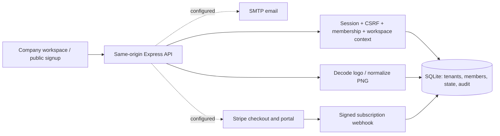

# Architecture and operation

## Runtime

Node.js 24.15+ serves the supplied vanilla HTML/CSS/JavaScript UI through Express 5. SQLite is accessed using Node's built-in `node:sqlite` API. Sharp normalizes company images. Stripe and Nodemailer are optional integration adapters. No frontend build or hosted account is required for local use.

The Supabase Postgres schema is maintained in `supabase/migrations/`. It is a provisioned database foundation, not yet the active runtime repository: Express still uses SQLite until the authentication and data-access cutover is implemented. See [the Supabase database notes](../supabase/README.md).

## Data model

- `users`: account identity, salted password hash and verification flag.
- `tenants`: unique slug, company name/color/logo, versioned CRM state, trial and billing identifiers.
- `members`: explicit user/tenant role. The user may belong to several companies.
- `sessions`: hashed opaque session token, account, active tenant, CSRF token and expiry.
- `invites` / `actions`: hashed, expiring, one-time invitation and account-action tokens.
- `audit`: tenant-scoped server audit entries, newest 200 exposed in the UI.
- `billing_events`: processed webhook IDs for idempotency.
- `rate_limits`: persistent counters for authentication and public submissions.
- `signup_requests`: company-scoped website requests including wording and timestamp. These are not verified subscribers.

CRM records live in a versioned tenant JSON document. Updates validate the schema, permissions, quotas and current version before writing. The frontend serializes writes. A conflict rolls back to current server data and shows an error, preventing silent overwrites. This deliberately favors a small, runnable migration over a full replacement of the supplied CRM.

This is a **single Node instance with durable local storage** architecture. Do not put the SQLite file on a network share or deploy this unmodified to ephemeral serverless storage. Before high-volume/multi-instance deployment, normalize customer/message tables, move to a transactional shared database, add pagination and enforce tenant conditions in repository access or row policies. A 16 MB document ceiling and application quotas bound this version's workspace size.

## Access enforcement

The tenant is resolved only from the authenticated session and current database membership. A client-supplied `X-Workspace-Id` must match that session, preventing an old browser tab from writing the wrong company after a shared cookie switches workspace. It never authorizes a tenant by itself. `GET /api/session` bootstraps the current context; other private requests need that header. Mutating authenticated requests also require `X-CSRF-Token`.

Platform operator routes are separately gated by the exact `PLATFORM_ADMIN_EMAILS` server allowlist in addition to normal authentication, current membership, workspace binding and CSRF. Tenant owner/admin roles do not grant these routes. Operator actions are recorded in global audit entries; suspension keeps tenant data and billing status while blocking writes, and account access revocation removes all active sessions.

JSON requests from cross-site origins are rejected. No wildcard CORS is enabled. Static assets use an explicit allowlist; `.env`, database files and server code are never served. CSP, `nosniff`, frame restrictions, same-origin referrer policy and no-store caching are set centrally. Production enables HSTS and Secure cookies.

Images have a 2 MB source limit and 16 megapixel decode limit. They are normalized to PNG at up to 512 × 512. The public logo endpoint is intentional branding access. Public company metadata does not expose account emails, team lists or CRM data.

## External integrations

### Email

Set `SMTP_URL` and `MAIL_FROM`. Registration attempts a verification email; failed delivery does not discard the new company. An administrator can resend verification from Account & security. Password recovery requires outbound email and returns a generic account-existence response. Invitations can also be copied manually when SMTP is absent or delivery fails. One-time raw links are not stored in the database.

### Stripe

Set the server secret key, signing secret and three recurring monthly INR price IDs. The catalog's amounts and limits are in `PLANS` in server.mjs; public pricing fallback is in saas.js and must be kept aligned. Configure the Stripe portal to allow the desired plans and cancellation behavior.

Point the Stripe webhook to `https://YOUR_DOMAIN/api/billing/webhook`. Subscribe to `customer.subscription.created`, `customer.subscription.updated` and `customer.subscription.deleted`. The route receives raw JSON, verifies its signature and reconciles the current subscription using Stripe's API. Add a scheduled reconciliation worker before a production launch to recover from prolonged webhook outages.

Checkout only creates a customer and session. It does not grant an entitlement. Unknown price IDs fail closed. A canceled subscription may begin a new checkout; existing subscriptions are managed through the portal. Provider test doubles in API tests exercise behavior without charging real cards. Live acceptance still requires Stripe test-mode configuration.

### WhatsApp and AI

WhatsApp Cloud API connection, live text/body-template sends, raw-body signed inbound/receipts, tenant routing, encrypted credentials and signed consent/STOP handling are implemented in `whatsapp.mjs`. The live inbox uses separate normalized tables so browser CRM JSON cannot forge provider state. See WHATSAPP.md for activation and supported message types. Existing CRM campaign/template entries and automation/assistant settings remain drafts/configuration. AI execution and bulk sending are not integrated.

## Operations

Use `npm start` from the project root and keep its terminal running. The server listens on `127.0.0.1`; use an HTTPS reverse proxy to expose it. Set an absolute `DATABASE_PATH` on a durable local disk for deployment. `APP_URL` must be the public HTTPS origin in production. `.env` is loaded only on launch; restart after changing it.

Back up the SQLite database using an SQLite online backup or `VACUUM INTO` during a controlled maintenance workflow. Do not copy only the main database while ignoring active WAL files. Keep backups encrypted and access-controlled, and test restoration. Backups, observability and deployment are operator tasks and are not automated in this repository.

The nested `Techzolo-WhatsApp-HTML/` directory was an identical copy of the original preview. Its HTML entrypoints now reference the canonical root assets, and the Node server redirects those legacy URLs. New work should use the project root.
